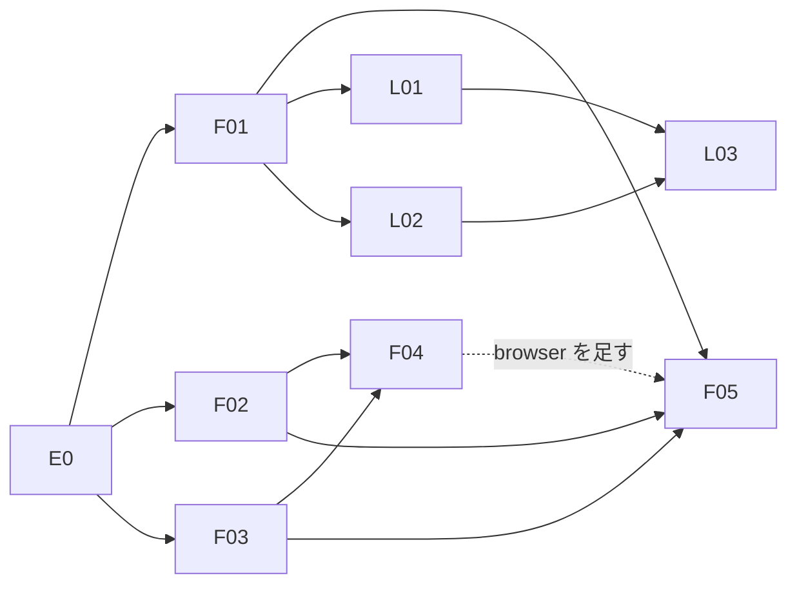

# chatsumi 計画

chatsumi は外のデータを摘んでくる窓口。docker01 で動くコンテナで、yunomi から Cloudflare Tunnel + Access のサービストークンで HTTP で呼ばれる。保存、スケジュール、通知は持たず、DO・Queue・D1 も使わない。RSS は Miniflux、ページの見張りは changedetection.io に任せ、chatsumi はそれを読み出すだけにする。

この repo はコードと GHCR へのイメージ公開だけを持つ。compose は chabatake の `docker01/chatsumi/`、Tunnel と Access は chabatake の `cloudflare/`、secret は 1Password の `chabatake-services/*` にあり、Komodo が配置する。

## Goal

1. 段階 1：yunomi の `web_fetch`（CE8）が `fetchText` を呼び、貼られた URL のタイトルと本文を読める。JavaScript で描画するページや、http の取得が弾かれるページも、共有ブラウザで読める。
2. 段階 2：yunomi の CE9 が `listRecent` を呼び、Miniflux の RSS の新着と changedetection.io の見張りの変化を、同じ形で読める。

## API

どちらも `POST` で JSON を受けて JSON を返す。入力は Valibot で検証し、不正なら 400 を返す。

### `POST /fetchText`

入力：

| 項目 | 型 | 内容 |
| --- | --- | --- |
| `url` | string | http / https の URL。2048 文字まで |
| `mode` | `"http"` \| `"browser"`（省略可） | 省くと自動で切り替える |

成功：`{ ok: true, title, text, truncated, finalUrl, mode, status }`

- `title` はページの `<title>`（なければ `null`）。512 文字まで。
- `text` は本文のテキスト。ブロック要素の境目で改行し、空行を詰める。既定で 20,000 文字に切り詰め、切り詰めたら `truncated: true`。
- `finalUrl` はリダイレクトを辿った後の URL、`mode` は実際に使った取り方。

失敗：`{ ok: false, error: { type, message, mode } }`。HTTP のステータスは 200 で返し、`type` で判別する。

| `type` | 意味 |
| --- | --- |
| `ssrf_blocked` | 宛先が内部のアドレス、許していないスキームやポート |
| `not_found` | 404 / 410 |
| `auth_required` | 401 / 407 |
| `forbidden` | 403（challenge の印がない） |
| `challenge` | Cloudflare などの challenge、captcha |
| `rate_limited` | 429 |
| `upstream_error` | 5xx、想定外のステータス |
| `too_large` | 展開後の本文が上限（5 MiB）を超えた |
| `unsupported_content_type` | HTML とテキスト以外 |
| `timeout` | 全体の制限時間を超えた |
| `network_error` | DNS の失敗、接続の失敗、リダイレクトの上限 |
| `browser_unavailable` | 共有ブラウザにつながらない |

### mode の自動切り替え

`mode` を省くと http で取り、次のときだけ browser でやり直す。

- 弾かれた：`forbidden`、`challenge`、`rate_limited`
- 中身が空：取得は成功したが、本文のテキストが 200 文字に満たない

`ssrf_blocked`、`not_found`、`auth_required`、`too_large`、`unsupported_content_type`、`timeout` はやり直さない。browser でも結果が変わらないか、制限時間を使い切っているため。弾かれてやり直した browser も失敗したときは、browser の失敗を返す。中身が空でやり直した browser が失敗したときは、http の結果を返す。

### `POST /listRecent`（段階 2）

入力：`{ since, source?, limit }`。`since` は ISO 8601 の時刻、`source` は `"miniflux"` \| `"changedetection"`（省くと両方）、`limit` は 1〜100。

成功：`{ ok: true, items: [{ source, id, title, url, publishedAt, summary }] }`。`publishedAt` の新しい順に並べ、`limit` 件で切る。

### 認証

Cloudflare Access がサービストークンを確かめた後、chatsumi も `Cf-Access-Jwt-Assertion` の JWT を検証する（チームドメインの JWKS、`aud`、有効期限）。chatsumi は宛先を選べる取得口なので、docker01 の同じネットワークにいる別のコンテナから素通しで呼べないようにする。`/healthz` だけは検証しない。

## SSRF の検査

utsuroi の `executors/shared`（Node 版）を移植する。

- スキームは http / https、ポートは 80 / 443 だけ。userinfo 付きの URL は拒否する。
- `localhost`、`metadata.google.internal` などの名前と、`.localhost`、`.local`、`.internal`、`.localdomain`、`.home.arpa` で終わる名前は DNS を引く前に拒否する。
- DNS で全レコードを引き、1 つでも拒否範囲に入れば名前ごと拒否する。拒否範囲は IPv4 のプライベート、ループバック、リンクローカル、CGN、文書用、マルチキャスト、予約と、IPv6 のループバック、ULA、リンクローカル、IPv4 を埋め込める形式（mapped、NAT64、6to4、Teredo）。環境変数で宅内の公開アドレスなどの CIDR を足せる。
- 接続先は検査したアドレスに固定する（`lookup` の差し替え）。DNS の rebinding で検査後に宛先がすり替わらないようにするため。
- リダイレクトは手で辿り、1 回ごとに同じ検査をやり直す。上限は 5 回。

browser の取得では、ページが出すすべてのリクエスト（iframe とポップアップを含む）を context の `route` で止めて同じ検査を通す。WebSocket と Service Worker は使わせない。

文書のリクエストを chatsumi 側で取って `route.fulfill` で返せばリダイレクトも止められるが、それでは TLS の指紋が Node のものになり、browser に切り替える意味がなくなる。そこで文書もブラウザに取らせ、route で止められない 2 つの経路は後から確かめる。

- リダイレクトの先：Playwright の route はリダイレクトの先を止めない
- DNS の rebinding：検査の後にブラウザが自分で DNS を引き直す

すべての応答の接続先アドレス（`response.serverAddr()`）を確かめ、拒否範囲に届いた応答が 1 つでもあれば取得結果ごと捨てて `ssrf_blocked` を返す。中身は chatsumi の外に出ないが、内部のアドレスへの GET が 1 回届くことは防げない。これは共有ブラウザのコンテナの外向きの通信を chabatake 側で絞って塞ぐ。

## Epic 一覧

| Epic | ユーザーから見える成果 | 依存 |
| --- | --- | --- |
| E0 | repo の土台。CI が通り、GHCR にイメージが出る | なし |
| E1 | 段階 1。`fetchText` で http と browser の両方の取り方で URL を読める | E0 |
| E2 | 段階 2。`listRecent` で Miniflux と changedetection.io の新着を読める | E1 の F01 |

### E0. 土台

- 技術範囲：Node 24 + TypeScript + pnpm、Biome、Vitest、Dockerfile、CI、GHCR へイメージを出す workflow、CLAUDE.md。
- Done：PR の CI が通り、`main` への push で `ghcr.io/ochanuco/chatsumi` にイメージが出る。

### E1. fetchText（段階 1）

- 技術範囲：HTTP API の骨組みと Access の JWT の検証、SSRF の検査つきの http の取得、本文の取り出し（文字コード、タイトル、本文、切り詰め）、共有ブラウザ（sockpuppetbrowser、`ws://host.docker.internal:3000`）への `connectOverCDP` での取得、mode の自動切り替え。
- 非ゴール：robots.txt の解釈、Readability のような本文だけの抽出、キャッシュ、PDF などの HTML 以外の本文、Cloud Run での取得。
- Done：各経路が unit test で保証され、docker01 に配置した chatsumi を yunomi から呼んで、静的なページと JavaScript で描画するページの両方を読める。

### E2. listRecent（段階 2）

- 技術範囲：Miniflux の API（`/v1/entries`、`published_after`）と changedetection.io の API（見張りの一覧と最終変化の時刻）の adapter、同じ形へのそろえ方、`listRecent` の組み立て。OSS の差し替えは adapter の中で済ませ、API の形は変えない。
- 非ゴール：フィードや見張り先の登録（管理画面か API で入れる）、既読の管理、本文の取得。
- Done：fake の API を使ったテストで、両方の新着が混ざって新しい順に並び、`since`、`source`、`limit` が効く。片方の API が落ちていても、もう片方の結果と失敗した source が返る。

## Issue 一覧

番号は計画上の ID。右端の列が GitHub Issue の番号。

| ID | Epic | タイトル | 依存 | 並行 | GitHub |
| --- | --- | --- | --- | --- | --- |
| F01 | E1 | HTTP API の骨組みと Access の JWT の検証 | E0 | F02, F03 と並行 | #2 |
| F02 | E1 | SSRF の検査と http の取得 | E0 | F01, F03 と並行 | #3 |
| F03 | E1 | 本文の取り出し（文字コード、タイトル、本文） | E0 | F01, F02 と並行 | #4 |
| F04 | E1 | 共有ブラウザでの取得 | F02, F03 | F05 と並行 | #5 |
| F05 | E1 | fetchText の組み立てと mode の自動切り替え | F01, F02, F03 | F04 と並行 | #6 |
| L01 | E2 | Miniflux の adapter | F01 | L02 と並行 | #7 |
| L02 | E2 | changedetection.io の adapter | F01 | L01 と並行 | #8 |
| L03 | E2 | listRecent の組み立て | L01, L02 | - | #9 |

## 依存グラフ

F05 は F04 を待たずに http だけで組み立て、F04 が入ったら browser への切り替えを足す。

## 確かめておくこと

- sockpuppetbrowser は接続ごとにブラウザを立ち上げる。Playwright の `connectOverCDP` で接続でき、`browser.close()` で後始末されるかを docker01 で確かめる。
- sockpuppetbrowser の同時接続の上限と、changedetection.io と取り合ったときの待ち方。chatsumi 側でも browser の同時実行を絞る。
- 共有ブラウザのコンテナから宅内のネットワークと docker01 のほかのコンテナへの通信を絞れるか（上の SSRF の残りを塞ぐため）。
- Cloudflare Access の JWT を chatsumi で検証するために、チームドメインと Application の AUD を chabatake の `docker01/chatsumi/` の環境変数に渡す。

## 判断が必要な点

- 本文の切り詰めの長さ（20,000 文字）と「中身が空」の閾値（200 文字）。yunomi の `web_fetch` の使い方を見て調整する。
